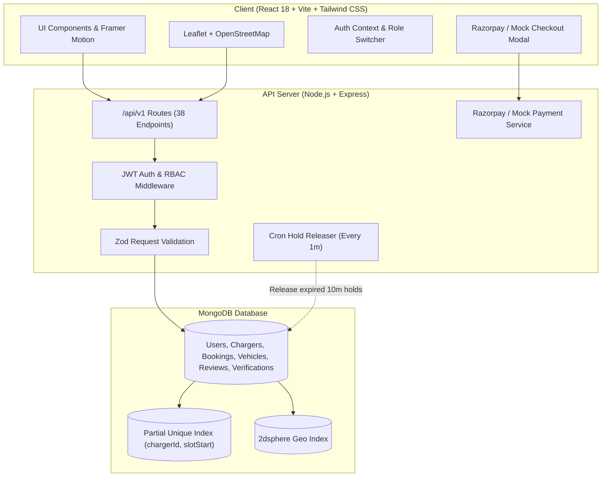
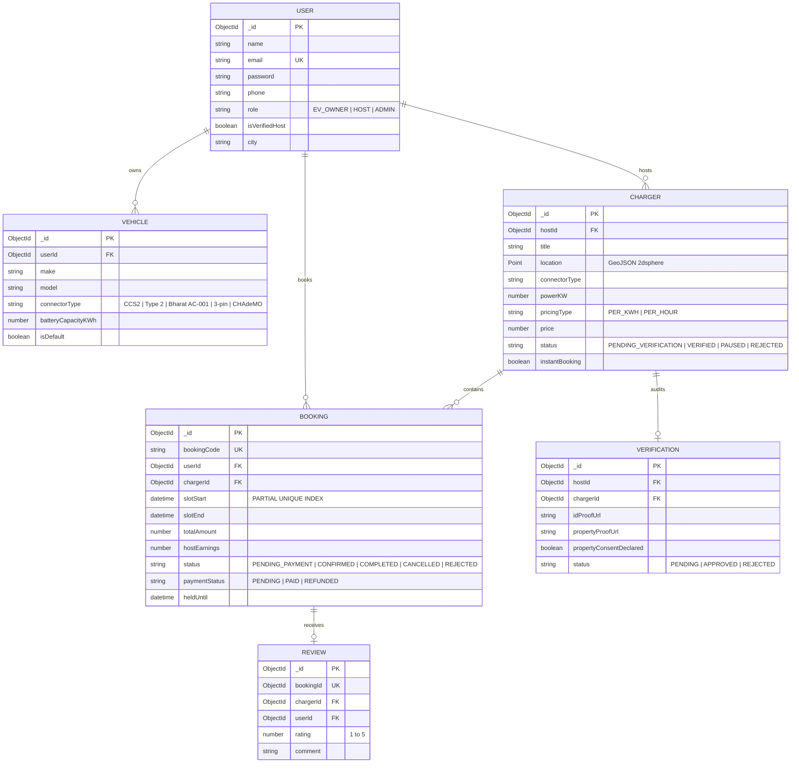

# ⚡ ChargeShare India

> **Peer-to-Peer Electric Vehicle (EV) Charging Marketplace for India**  
> *"Charge anywhere. Earn from your socket."*

[]()
[]()
[]()
[]()
[]()
[]()

---

## 🌟 1. Overview & Problem Solved

Electric mobility adoption in India is surging, yet **public charging infrastructure is heavily congested and capital-intensive**. Most EV owners face broken chargers, hour-long queues, or range anxiety on intercity routes.

At the same time, **thousands of private 7.4kW–22kW AC wallboxes and 50kW DC chargers sit idle for 18+ hours a day** in bungalow driveways, apartment society parking bays, and commercial complexes.

**ChargeShare India** transforms private charging sockets into verified, revenue-generating smart community hubs with:
- **EV Owners:** Search nearby verified chargers via interactive OpenStreetMap, select discrete 30/60-min slots, pay seamlessly via Razorpay, and check-in with dynamic QR passes.
- **Charger Hosts:** Monetize idle sockets (earning ₹15,000–₹45,000+/mo), set dynamic availability, and manage bookings.
- **Admin Safety Verification:** Enforces electrical safety audits (dedicated earthing, 32A MCBs, 30mA RCCB shock trip, IP65 weatherproof covers) and legal property ownership / society NOC declarations before any charger appears in public searches.

---

## 📐 2. Architecture & Flow



---

## 🗄️ 3. Entity-Relationship (ER) Data Model



---

## 🛡️ 4. Key Engineering Decisions

### 1. Zero Double-Booking Guarantee (Race Condition Prevention)
Traditional web applications check slot availability with a `findOne()` query followed by a `create()` call. Under high concurrent traffic (e.g. 20+ EV drivers simultaneously reserving the exact same charging slot), this causes severe **Time-Of-Check to Time-Of-Use (TOCTOU)** race conditions leading to disastrous double-bookings at physical chargers.

**ChargeShare Solution:**
1. Availability is modeled as **discrete time slots** with immutable `slotStart` timestamps.
2. A database-enforced **UNIQUE partial index** is registered on `(chargerId, slotStart)`:
   ```javascript
   bookingSchema.index(
     { chargerId: 1, slotStart: 1 },
     {
       unique: true,
       partialFilterExpression: {
         status: { $in: ['PENDING_PAYMENT', 'CONFIRMED'] },
       },
     }
   );
   ```
3. When a driver selects a slot, the system creates a `PENDING_PAYMENT` document which reserves the slot for **10 minutes**.
4. If 25 concurrent requests race for the same slot, MongoDB atomically enforces index uniqueness: exactly **1 request succeeds with HTTP 201 Created**, and the remaining **24 concurrent requests are immediately rejected with HTTP 409 Conflict** and a user-friendly message.
5. If the user does not complete checkout within 10 minutes, a background cron/TTL worker automatically cancels the hold and returns the slot to available inventory.

### 2. Tiered Cancellation & Refund Rules
To protect host revenue while maintaining driver flexibility, cancellations follow automated tiered rules:
- **> 2 Hours before slot start:** **100% Full Refund**
- **Within 2 Hours of slot start:** **50% Refund**
- **After slot start:** **0% Refund**
- **Host / Admin Cancellation:** **100% Full Refund** unconditionally

### 3. Safety Verification & Property Consent Flow
To prevent fire hazards and society disputes:
- New listings are created with `status: PENDING_VERIFICATION`.
- Unverified chargers are **completely excluded** from EV owner searches.
- Hosts must pass an electrical checklist (Earthing resistance < 3 Ohms, 32A MCB, 30mA RCCB, IP65 weatherproof, CCTV) and formally declare property ownership or housing society NOC consent.
- Admin audits documents in the verification queue before toggling status to `VERIFIED`.

### 4. Zero-Setup Mock Payment Simulator Fallback
While full Razorpay test mode integration is implemented (order creation, signature hashing verification, webhook safety), the app automatically falls back to an **instant one-click mock payment simulator** if Razorpay API keys are omitted in `.env`, allowing reviewers and evaluators to test complete end-to-end booking flows without configuration hurdles.

---

## ⚡ 5. Concurrency Test Results

As verified by our automated Jest concurrency test (`tests/concurrency.test.js`):

```bash
===============================================================
⚡ CHARGESHARE INDIA CONCURRENCY TEST RESULT
===============================================================
Total simultaneous requests fired: 25
✅ HTTP 201 Created (Booking Succeeded)    : 1
🛡️  HTTP 409 Conflict (Double-Booking Blocked): 24
❌ Unexpected Error Responses              : 0
===============================================================
STATUS: PASS - Zero double-bookings allowed under heavy race conditions.
```

---

## 🚀 6. Quickstart & Local Setup

### Prerequisites
- Node.js v18+ (tested on Node v22)
- npm v9+

### 1. Clone & Install
```bash
git clone https://github.com/your-org/chargeshare-india.git
cd chargeshare-india
npm install
```

### 2. Environment Variables
Copy `.env.example` in `server/`:
```bash
cp server/.env.example server/.env
```
Default `.env` settings:
```env
PORT=5000
NODE_ENV=development
CLIENT_URL=http://localhost:5173
MONGODB_URI=mongodb://localhost:27017/chargeshare_india
# Generate random secrets via: node -e "console.log(require('crypto').randomBytes(64).toString('hex'))"
JWT_SECRET=replace-with-64-random-hex-characters
ADMIN_JWT_SECRET=replace-with-64-random-hex-characters
DOCUMENT_LINK_SECRET=replace-with-64-random-hex-characters
JWT_EXPIRES_IN=7d
ADMIN_JWT_EXPIRES_IN=30m
PLATFORM_FEE_PERCENT=5
HOLD_EXPIRY_MINUTES=10
```

### 3. Seed Database
Seeds 1 Admin, 5 Hosts, 3 EV Owners, 5 Vehicles, 30 Chargers across 6 Metros, 50 Bookings, and Reviews:
```bash
npm run seed
```
*(Note: If local MongoDB is not running, the seed script automatically spawns an embedded in-memory MongoDB instance to validate the entire seed pipeline!)*

### 4. Start Local Development
Run both Frontend (Vite) and Backend (Express) concurrently with a single command:
```bash
npm run dev
```
- **Frontend App:** [http://localhost:5173](http://localhost:5173)
- **Backend API:** [http://localhost:5000/api/v1](http://localhost:5000/api/v1)
- **Interactive Swagger Docs:** [http://localhost:5000/api/docs](http://localhost:5000/api/docs)

---

## 🔑 7. Demo Credentials

The platform includes **1-click quick persona switcher buttons** right on the navigation bar and login screen:

| Role | Email | Password | Preloaded Data |
|---|---|---|---|
| **EV Owner** | `owner1@chargeshare.in` | `OwnerPassword123!` | Nexon EV Max, 3-pin Ather, active bookings |
| **Charger Host** | `host1@chargeshare.in` | `HostPassword123!` | 7 Koramangala & Indiranagar chargers, earnings |

> **Note:** Administrative accounts do **not** have 1-click demo persona buttons and cannot be accessed via public sign-in. Admins sign in exclusively at the dedicated back-office portal (`/admin/login`).

---

## 🧪 8. Test Suite Summary

Run all 48 Jest + Supertest unit and integration tests:
```bash
npm test
```
Or run the concurrency double-booking race condition test individually:
```bash
npm run test:concurrency
```

### Test Coverage Report:
- **Total Test Suites:** 8
- **Total Tests:** 48 passing (100% pass rate)
  - `auth.test.js`: 11 tests (Register, Login, JWT, Validation, Phone regex, RBAC)
  - `vehicles.test.js`: 7 tests (Vehicle CRUD, connector validation, ownership isolation)
  - `chargers.test.js`: 8 tests (Geo search, verified filters, schedule availability, pause/delete)
  - `bookings.test.js`: 7 tests (10-min slot hold, 5% fee, QR generation, tiered refunds >2h/50%/0%)
  - `payments.test.js`: 3 tests (Order creation, signature check, mock pay simulator)
  - `reviews.test.js`: 5 tests (Completed session requirement, 1 review per booking, rating average recalc)
  - `verification.test.js`: 6 tests (KYC docs, safety checklist, admin approve/reject, platform stats)
  - `concurrency.test.js`: 1 high-concurrency race condition test (25 concurrent requests)

---

## 📡 9. REST API Summary (38 Versioned Endpoints)

Full interactive OpenAPI 3.0 documentation is served at `/api/docs`. A Postman collection is also provided in [`ChargeShare_India.postman_collection.json`](./ChargeShare_India.postman_collection.json).

### Auth & Profile (`/api/v1/auth`)
- `POST /register` - Register EV Owner or Host (with Indian phone validation)
- `POST /login` - Sign in and receive JWT token + httpOnly cookie
- `POST /logout` - Invalidate session
- `GET /me` - Get current authenticated user profile
- `PUT /profile` - Update profile, avatar, or city

### Vehicles (`/api/v1/vehicles`)
- `POST /` - Add EV vehicle (Make, Model, Year, Registration, Connector)
- `GET /` - List authenticated user's vehicles
- `GET /:id` - Get vehicle details
- `PUT /:id` - Update vehicle details
- `DELETE /:id` - Remove vehicle from garage

### Chargers (`/api/v1/chargers`)
- `GET /` - Search chargers with geo coordinates, radius, connector, power, price
- `GET /my/listings` - Host list their own chargers
- `GET /:id` - Get charger details & host profile
- `GET /:id/availability` - Get discrete 30/60-min slot availability for a date
- `POST /` - Host create charger listing (default: `PENDING_VERIFICATION`)
- `PUT /:id` - Host update charger specs & price
- `PATCH /:id/pause` - Host toggle pause / unpause listing
- `DELETE /:id` - Host delete listing

### Bookings (`/api/v1/bookings`)
- `POST /` - Reserve and hold slot for 10 minutes (Concurrency protected)
- `POST /confirm` - Confirm booking after payment & generate check-in QR code
- `GET /` - List user's or host's bookings (Upcoming, Completed, Cancelled)
- `GET /:id` - Get booking details with dynamic QR pass
- `POST /:id/cancel` - Cancel booking with tiered refund (>2h 100%, <2h 50%, start 0%)
- `POST /:id/action` - Host confirm or reject reservation

### Payments (`/api/v1/payments`)
- `POST /create-order` - Create Razorpay order (or mock order fallback)
- `POST /verify` - Webhook-safe signature verification
- `POST /mock-pay` - Instant 1-click test payment simulator

### Reviews (`/api/v1/reviews`)
- `POST /` - Submit review (verified EV owner only, 1 per completed booking)
- `GET /charger/:chargerId` - Get all reviews & average rating for charger

### Verification & KYC (`/api/v1/verifications`)
- `POST /` - Host submit Aadhaar/PAN, electricity bill/society NOC, and safety checklist
- `GET /my/:chargerId` - Host view verification status
- `GET /pending` - Admin view pending verification queue
- `POST /:id/review` - Admin approve or reject with feedback

### Admin & Analytics (`/api/v1/admin`)
- `GET /stats` - Platform metrics (Users, Chargers, Bookings, GMV, 5% Revenue)
- `GET /chargers` - Admin list all chargers with filter & search
- `GET /users` - Admin list all users with role filter
- `GET /host-stats` - Host dashboard metrics, utilization %, and monthly earnings

### Uploads (`/api/v1/uploads`)
- `POST /` - Upload document PDF or image via Multer

---

## ☁️ 10. Deployment Guide

### Deploying Database on MongoDB Atlas
1. Create a free M0 cluster at [mongodb.com/atlas](https://www.mongodb.com/atlas).
2. Create database user and allow network access (`0.0.0.0/0`).
3. Copy connection string: `mongodb+srv://<user>:<password>@cluster0.mongodb.net/chargeshare_india?retryWrites=true&w=majority`.

### Deploying Backend on Render
1. Create a new Web Service connected to your repository on [render.com](https://render.com).
2. Configure using `render.yaml` or manual settings:
   - **Root Directory:** `server`
   - **Build Command:** `npm install`
   - **Start Command:** `npm start`
3. Add Environment Variables:
   - `NODE_ENV`: `production`
   - `PORT`: `10000`
   - `MONGODB_URI`: `<Your MongoDB Atlas URI>`
   - `JWT_SECRET`: `<Secure Random 64-char String>`
   - `ADMIN_JWT_SECRET`: `<Secure Random 64-char String>`
   - `DOCUMENT_LINK_SECRET`: `<Secure Random 64-char String>`
   - `CLIENT_URL`: `https://your-app.vercel.app`
   - `PLATFORM_FEE_PERCENT`: `5`

### Deploying Frontend on Vercel
1. Import repository at [vercel.com](https://vercel.com).
2. Select **Root Directory:** `client`.
3. Framework Preset: **Vite**.
4. Configure Rewrites in `client/vercel.json` (already pre-configured).
5. Add Environment Variable:
   - `VITE_API_BASE_URL`: `https://your-backend.onrender.com/api/v1`
6. Click **Deploy**.

---

## 💻 Tech Stack Summary

- **Frontend:** React 18, Vite, React Router v6, Tailwind CSS, Framer Motion, Leaflet + React-Leaflet, Axios, React Hook Form + Zod, Recharts, Lucide React, @fontsource/plus-jakarta-sans, Canvas-Confetti, QRCode.react.
- **Backend:** Node.js, Express, MongoDB with Mongoose, JWT (httpOnly & bearer), bcryptjs, Zod validation middleware, Helmet, CORS, Express-Rate-Limit, Razorpay SDK, QRCode generator, Multer, Swagger UI Express.
- **Testing:** Jest, Supertest, mongodb-memory-server.
- **Tooling:** ESLint, Prettier, Dotenv, Concurrently.


---

## 🎨 11. Visual Redesign & Design System

The frontend underwent a complete visual overhaul replacing generic harsh neon flooding with a modern dark/light system:

### Visual Transformation Highlights
- **Design System Tokens:** CSS variables and Tailwind tokens for both `.dark` and `.light` modes (`#070B14` base, `#0E1626` raised, `#152036` elevated, `#34D399` emerald brand accent, `#22D3EE` cyan link/pin accent, `#FBBF24` amber ratings/tariff).
- **Typography:** `Plus Jakarta Sans` for display headlines (weights 700–800) + `Inter` for body.
- **Map Aesthetics:** CartoDB Dark Matter / Positron vector tiles (zero API key needed) with custom SVG teardrop pins, hover price chips, and selected pin glow.
- **Booking Experience:** 4-step progress stepper, horizontal day pills, morning/afternoon/evening discrete slot grids, live 10-minute database hold countdown ring, and perforated ticket confirmation passes with downloadable `.ics` calendar events and Google Maps directions.
- **Audit Verification:** Headless Chrome screenshot audit captured 16 before/after comparison screenshots at 1280px (desktop) and 360px (mobile) in `docs/screenshots/before/` and `docs/screenshots/after/`.
- Full details documented in [`docs/REDESIGN_DECISIONS.md`](docs/REDESIGN_DECISIONS.md).

---

## 🛡️ 12. Legal, Security & DPDP Act 2023 Compliance

### Indian Data Protection & Consumer Safeguards
- **DPDP Act 2023 Compliance:** Designated Data Protection / Grievance Officer (Ms. Aditi Sharma, `grievance@chargeshare.in`, 7 business days turnaround) under Section 10 of the Digital Personal Data Protection Act, 2023.
- **Right to Be Forgotten:** Self-service account data erasure (`POST /api/v1/auth/delete-account`) requiring the user to explicitly type `"DELETE"`. Atomically anonymizes PII (`Deleted User`, `+910000000000`), cancels upcoming bookings with policy refunds, unlists host chargers, and revokes JWTs.
- **Granular Cookie Consent:** Categorized into Strictly Necessary (auth/CSRF), Preferences (map zoom & connector filter), and Performance Analytics, managed via `CookieConsent.jsx` and reconfigurable from the footer.
- **Transparent Refund Policy:** Exact automated tier implementation:
  - `> 2 hours before slot:` 100% full refund
  - `<= 2 hours before slot:` 50% partial refund
  - `After session start:` 0% non-refundable
- **Account Security & Session Management:**
  - Single-use 30-minute cryptographic password reset tokens with SHA-256 hash storage.
  - Multi-device session revocation via `tokenVersion` (`POST /api/v1/auth/logout-all`).
  - Brute-force account lockout backoff (5 consecutive failed attempts locks account for 15 minutes).
  - Strong password validator (minimum 10 characters, mixed case, numbers, and symbols).
  - Strict Content-Security-Policy (CSP) headers protecting map tile and payment frames.
- **Portfolio / Demo Legal Notice:**
  > *"Demo project. Payments run in test mode. Policy text is a template, not legal advice."* Zero invented corporate numbers (no fake CIN/GST/PAN). Dedicated exclusive geofence to Bengaluru, Karnataka.

---

## 📱 13. Responsive Design & Cross-Device Engineering

ChargeShare India features a mobile-first responsive architecture designed and tested from 320px ultra-compact phones (Galaxy Fold cover screen, iPhone SE) up to 2560px 4K ultrawide monitors.

### Architectural Principles
1. **Fluid Typography & Containers:** Container queries and CSS `clamp()` (`clamp(2.75rem, 15vw, 14rem)` for hero editorial headings) prevent text clipping and line wraps on 320px displays without horizontal overflow (`overflow-x: clip`).
2. **Safe Area & Dynamic Viewport:** Enforces `env(safe-area-inset-*)` padding utilities (`pt-safe`, `pb-safe`) for notched displays (iPhone Dynamic Island, home indicator) and standardizes on `100dvh` / `100svh` to eliminate jumping when mobile browser URL bars appear/collapse.
3. **Touch Targets (WCAG 2.5.5 Level AAA / 2.5.8 Level AA):** All interactive elements (buttons, inputs, bottom navigation pills, map zoom controls, sheet handles) enforce a minimum touch bounding box of `44x44px` on coarse pointers (`.touch-target-min`).
4. **Interactive Bottom Sheet for Maps:** On viewports under `1024px`, the Bengaluru explore map shifts from a desktop split-grid to an interactive draggable bottom sheet with 3 tactile snap positions (`peek` 96px, `half` 48dvh, `full` 82dvh) with `touch-action: pan-y` and automatic Leaflet `invalidateSize()` recalculation.
5. **No Auto-Zoom on iOS Inputs:** Mobile text and number inputs specify a minimum `16px` font size on touch viewports, preventing Safari iOS from triggering automatic zooming on input focus.
6. **Accessible Navigation:** Desktop links collapse on mobile into a slide-out drawer with backdrop blur, focus trap, and hardware back gesture (`popstate`) support.

### Testing on Real Physical Devices over LAN

To test the application on your physical smartphone or tablet on the same Wi-Fi network:

```bash
# 1. Start the backend API server
npm --prefix server run dev

# 2. Start the Vite client in LAN host mode
npm --prefix client run dev:lan
```

Vite will print both local and LAN access URLs:
```
  ➜  Local:   http://localhost:5173/
  ➜  Network: http://192.168.1.15:5173/
```
Open the **Network URL** on your phone's browser (Safari on iOS, Chrome on Android).

### Remote Debugging Guide

#### Android (Google Chrome)
1. Enable **Developer Options** on your Android phone (tap *Build Number* 7 times in *Settings > About Phone*).
2. Enable **USB Debugging** in *Developer Options*.
3. Connect your phone to your PC via USB.
4. On your PC, open Chrome and navigate to `chrome://inspect/#devices`.
5. Locate your connected phone under **Remote Target** and click **Inspect** next to the ChargeShare tab to access full DevTools, console logs, and network telemetry.

#### iOS (Apple Safari)
1. On your iPhone/iPad, go to **Settings > Safari > Advanced** and toggle **Web Inspector** to ON.
2. Connect your iPhone to your Mac via a USB cable.
3. On your Mac, open Safari, navigate to **Develop > [Your iPhone Name]**, and select the ChargeShare URL.
4. On Windows, you can use the open-source [RemoteDebug iOS WebKit Adapter](https://github.com/RemoteDebug/remotedebug-ios-webkit-adapter) or Chrome DevTools device simulation mode.

### Running Automated Responsive Tests

ChargeShare includes automated Playwright responsive verification across 10 device profiles:

```bash
# Run responsive verification suite and capture after-screenshots
npm --prefix client run test:responsive
```
Generated screenshots are archived in [`docs/screenshots/responsive-after/`](docs/screenshots/responsive-after/).

---

## 🛡️ 14. Platform Administration, Safety Verification & Back-Office Access

The **ChargeShare Back-Office Console** (`/admin`) is a dedicated, production-grade operations center designed strictly for platform administrators. It provides full oversight of Bengaluru's peer-to-peer charging network without exposing administrative controls to public visitors or polluting admin accounts with rider/host tools.

### Core Back-Office Capabilities

1. **Safety & KYC Verification Console (`/admin/kyc`):**
   - **Queue Management:** Real-time triage of pending 16A socket listings submitted by hosts.
   - **5-Point Safety Checklist:** Mandatory audit criteria (identity verification, BESCOM utility bill matching, earthing test compliance <5V neutral-to-earth, MCB/RCCB trip rating, residential society NOC) before any socket is approved.
   - **Structured Review Actions:** Approve (activates bay), Reject (requires minimum 10-character reason with preset categories), or Request Resubmission.

2. **User Legitimacy & Risk Review (`/admin/users` & `/admin/users/:id`):**
   - **Privacy Minimization (DPDP Act 2023):** Displays masked PII in all public-facing and list views (`+91 ••••• ••123`, `a••••@example.com`). Full unmasked details require explicit inspection drawer actions and generate immutable audit entries.
   - **Automated Risk Signals:** Real-time heuristic scoring flagging high cancellation rates (>=40%), repeated failed payments, disposable email domains, and prior KYC rejections.
   - **Trust Standing State Machine:** Moderation statuses (`UNVERIFIED`, `VERIFIED`, `UNDER_REVIEW`, `FLAGGED`, `SUSPENDED`) with mandatory justification logs.
   - **Session Revocation:** Marking a user as `SUSPENDED` immediately revokes their active JWT sessions (`tokenVersion`), blocks future logins with HTTP 403 `ACCOUNT_SUSPENDED`, and unlists their chargers.
   - **Audited CSV Export:** Filtered user directory export with immediate `DATA_EXPORT` audit logging.

3. **Tamper-Proof Audit Trail (`/admin/audit`):**
   - Append-only MongoDB `AuditLog` collection recording every administrative action (`KYC_APPROVE`, `KYC_REJECT`, `USER_SUSPEND`, `LISTING_SUSPEND`, `DOCUMENT_VIEW`, `DATA_EXPORT`, `ADMIN_PASSWORD_RESET`).
   - Captures actor email, role, target entity, client IP address, user-agent, and exact reason string.

4. **Protected Document Storage & Viewing:**
   - Raw uploads are not exposed via static express routes.
   - Access to host utility bills and property documents is gated behind short-lived (10-minute) signed HMAC tokens (`/api/v1/documents/view/:filename?token=...`).
   - Every document preview sets `X-Content-Type-Options: nosniff`, `Content-Security-Policy: sandbox`, and logs a `DOCUMENT_VIEW` audit entry.

5. **Tool Isolation & Role Guarding:**
   - Public pages (`/`, `/explore`, `/login`) display the public header and navigation.
   - `/admin/*` is housed in an isolated back-office shell with collapsible sidebar navigation, system health telemetry, and light/dark theme toggles.
   - Admins visiting rider/host routes (`/my-bookings`, `/vehicles`, `/become-a-host`, `/host/dashboard`) or attempting to book bays receive clear restriction notices directing them back to the back-office console.

### Admin Access, Provisioning & Production Security

ChargeShare India features a **strictly isolated Admin Back-Office Portal** (`/admin/login`). Administrative accounts cannot sign in through the public rider/host login, cannot register through public sign-up, and never expose 1-click demo persona buttons.

#### 1. Admin Sign-In Portal
* **URL:** `https://your-domain.com/admin/login` (Local: `http://localhost:5173/admin/login`)
* **Behavior:** Authenticates only accounts with `role: "ADMIN"`. Returns a uniform 401 for unknown emails, incorrect passwords, or non-admin accounts.
* **Session Lifetime:** High-security 30-minute access token (`scope: "admin"`), 8-hour maximum session, and SameSite=Strict cookies in production.

#### 2. Creating the Initial Administrator

##### Method A: Interactive CLI Tool (Recommended for Local & Deployed Servers)
```bash
# From workspace root:
npm run create-admin

# Or directly in server package:
npm --prefix server run create-admin
```
Prompts interactively for Administrator Name, Email, and a strong password (12+ characters, uppercase, lowercase, digit, special character). The password is masked during entry and never printed or logged. Sets `mustChangePassword: true` so the admin is required to rotate credentials upon first back-office login.

##### Method B: Startup Environment Bootstrap (For Automated Container Deployments)
When deploying to containerized environments (Docker, Kubernetes, Render) with a fresh database:
```env
ADMIN_BOOTSTRAP_EMAIL="<ADMIN_EMAIL>"
ADMIN_BOOTSTRAP_PASSWORD="<ADMIN_PASSWORD>"
```
The server creates this administrative account on startup only when zero administrators exist in the database.

#### 3. Administrative Password Reset via CLI
Self-service password reset by email link is disabled for administrative accounts to prevent account takeovers via email interception. Password resets must be executed via the server CLI:
```bash
# Interactive prompt:
npm run reset-admin-password -- --email "<ADMIN_EMAIL>"

# Non-interactive CLI passing temporary password:
npm run reset-admin-password -- --email "<ADMIN_EMAIL>" --password "<NEW_TEMPORARY_PASSWORD>"
```
* Sets `mustChangePassword: true` (forces change on next login).
* Increments `tokenVersion` (immediately invalidates all active sessions across all devices).
* Generates an immutable `AuditLog` entry (`ADMIN_PASSWORD_RESET`).
* Never prints sensitive credentials to the terminal or log files.

#### 4. Two-Factor Authentication (2FA / TOTP) Statement
* **Status:** Designed and specified (TOTP via `otplib` and RFC 6238). Currently **not implemented** in the baseline deployment to avoid introducing third-party authenticator dependencies without customer SSO configuration. Administrative security is instead enforced through strict IP rate limiting (5 attempts/15 min), progressive account lockout, scoped session tokens (`scope: "admin"`), and new-device sign-in email alerts.

#### 5. Environment Variables & Security Matrix

| Variable | Default (Dev) | Production Recommended | Purpose |
|---|---|---|---|
| `NODE_ENV` | `development` | `production` | Enforces production security, secure cookies, and disables demo seeds |
| `DEMO_MODE` | `true` | `false` | Disables demo seeds and removes demo admin shortcuts from server |
| `VITE_DEMO_MODE` | `true` | `false` | Completely removes 1-click persona switchers and demo controls from UI |
| `ADMIN_BOOTSTRAP_EMAIL` | *(empty)* | `<ADMIN_EMAIL>` | Initial admin email on zero-admin databases |
| `ADMIN_BOOTSTRAP_PASSWORD` | *(empty)* | `<STRONG_PASSWORD>` | Initial admin password (min 12 chars) |
| `ADMIN_JWT_EXPIRES_IN` | `30m` | `30m` | Administrative access token lifetime |
| `JWT_EXPIRES_IN` | `7d` | `7d` | Public rider/host token lifetime |

#### 6. Production Deployment Checklist
1. Set `NODE_ENV=production`.
2. Set `DEMO_MODE=false` in `server/.env`.
3. Set `VITE_DEMO_MODE=false` in `client/.env`.
4. Run `npm run create-admin` (or provide `ADMIN_BOOTSTRAP_EMAIL` / `ADMIN_BOOTSTRAP_PASSWORD`).
5. Open `/admin/login` and authenticate with administrator credentials.
6. Complete mandatory password rotation on first login.
7. Verify that the public login page (`/login`) shows zero demo buttons and rejects administrative credentials.

### Running Test Suites

```bash
# 1. Run all backend test suites (13 suites, 98+ assertions including concurrency & back-office RBAC):
npm --prefix server test

# 2. Run client unit and Playwright integration tests (including admin back-office E2E):
npm --prefix client test

# 3. Verify clean ESLint and color token compliance:
npm --prefix client run lint
npm --prefix client run check:colors

# 4. Production build:
npm --prefix client run build
```


