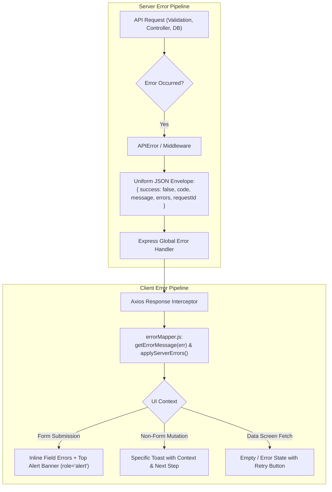

# Error UX & Resilience Audit

This audit evaluates error handling, catch blocks, and user feedback mechanisms across the ChargeShare India application (`/client` and `/server`).

---

## 1. Executive Summary & Core Defects

1. **Intrusive Native Browser Alerts:**
   - Multiple core mutation flows ([`VehiclesPage.jsx`](file:///c:/projects/ev_charger/client/src/pages/VehiclesPage.jsx), [`MyBookingsPage.jsx`](file:///c:/projects/ev_charger/client/src/pages/MyBookingsPage.jsx), [`HostDashboardPage.jsx`](file:///c:/projects/ev_charger/client/src/pages/HostDashboardPage.jsx), [`AdminDashboardPage.jsx`](file:///c:/projects/ev_charger/client/src/pages/AdminDashboardPage.jsx)) call native `alert(...)`.
   - *Impact:* Freezes the JavaScript thread, cannot be styled or themed, lacks accessibility attributes (`role="alert"`, `aria-live`), and provides no recovery CTA or retry button.

2. **Silent Failure & Blank States on Fetch:**
   - On initial data load failures (`getMyVehicles`, `getMyBookings`, `fetchHostData`, `fetchAdminData`, `getChargerById`), error blocks only execute `console.error(...)` while setting loading to false.
   - *Impact:* The UI renders empty states or indefinitely disabled views, misleading users into thinking they have 0 vehicles, 0 bookings, or 0 chargers when the network actually failed.

3. **Swallowed Technical Details & Generic Fallbacks:**
   - Many catch blocks fall back to strings like `'Failed to save vehicle'`, `'Failed to cancel booking'`, `'Failed to update profile'`, `'Submission Error'`.
   - Server-returned field validation arrays (`errors: [{ field, message }]`) are completely ignored on most forms, leaving inputs unhighlighted and forcing users to guess which field failed.

4. **Inconsistent Error Envelope & Missing Stable Codes:**
   - The server previously returned varying error shapes: some routes returned `{ success: false, message }`, others returned `{ success: false, errors }` or `{ success: false, error }`, almost all lacking machine-readable error `code` constants (e.g. `EMAIL_TAKEN`, `SLOT_TAKEN`, `HOLD_EXPIRED`, `UNAUTHENTICATED`).
   - Rate limiters returned non-standard error structures without machine-friendly retry metadata.

---

## 2. Action-by-Action Inventory

| Action | Component / File | Current Error Handling Code | Failure Symptoms & Deficiencies | Target Fixed Behavior |
| :--- | :--- | :--- | :--- | :--- |
| **User Login** | [`LoginPage.jsx`](file:///c:/projects/ev_charger/client/src/pages/LoginPage.jsx) | `setErrorMessage(err.response?.data?.message \|\| 'Invalid email or password')` | Single banner only. Doesn't distinguish 401 (bad credentials) vs 403 (account locked) vs 429 (rate limit). | Map `INVALID_CREDENTIALS`, `ACCOUNT_LOCKED` (showing countdown), `RATE_LIMITED`, autofocus on password. |
| **Email Verification** | [`LoginPage.jsx`](file:///c:/projects/ev_charger/client/src/pages/LoginPage.jsx) | `toast.error(err.response?.data?.message \|\| 'Verification token is invalid or expired.')` | Toast banner can vanish before reading. | Persistent banner on login screen with "Resend link" button. |
| **Registration** | [`RegisterPage.jsx`](file:///c:/projects/ev_charger/client/src/pages/RegisterPage.jsx) | Maps 409 and 400 validation, but lacks standardized `code` handling. | Good start from recent fix, but needs single client error mapper integration (`applyServerErrors`). | Standardized `code` mapping (`EMAIL_TAKEN`, `PHONE_REGISTERED`, `VALIDATION_FAILED`), inline field errors, `role="alert"`. |
| **Forgot Password** | [`ForgotPasswordPage.jsx`](file:///c:/projects/ev_charger/client/src/pages/ForgotPasswordPage.jsx) | `toast.error(err.response?.data?.message \|\| 'Failed to request password reset.')` | Floating toast, form remains without error styling; doesn't focus email field. | Form-level alert banner, inline email field error with autofocus, retry button on network error. |
| **Reset Password** | [`ResetPasswordPage.jsx`](file:///c:/projects/ev_charger/client/src/pages/ResetPasswordPage.jsx) | `toast.error(err.response?.data?.message \|\| 'Password reset token is invalid or expired.')` | Floating toast; missing inline field errors for password complexity failures. | Inline field errors under password inputs, `EXPIRED_TOKEN` banner with link to request new token. |
| **Profile Update** | [`SettingsPage.jsx`](file:///c:/projects/ev_charger/client/src/pages/SettingsPage.jsx) | `toast.error(err.response?.data?.message \|\| 'Failed to update profile.')` | Toast only; no inline highlighting if phone format or name length fails server validation. | Inline errors on name/phone inputs, autofocus on invalid field, specific toast on success. |
| **Password Change** | [`SettingsPage.jsx`](file:///c:/projects/ev_charger/client/src/pages/SettingsPage.jsx) | `toast.error(msg)` from catch block | Generic toast; does not highlight whether `currentPassword` was wrong or `newPassword` was weak. | Specific field errors (`currentPassword`: "Incorrect password", `newPassword`: complexity rules). |
| **Logout All Devices** | [`SettingsPage.jsx`](file:///c:/projects/ev_charger/client/src/pages/SettingsPage.jsx) & [`AccountSettingsModal.jsx`](file:///c:/projects/ev_charger/client/src/components/common/AccountSettingsModal.jsx) | `toast.error(err.response?.data?.message \|\| 'Failed to invalidate device sessions.')` | Generic toast; modal stays open with no guidance. | In-modal alert with retry button and clear message. |
| **Account Deletion (DPDP)** | [`SettingsPage.jsx`](file:///c:/projects/ev_charger/client/src/pages/SettingsPage.jsx) & [`AccountSettingsModal.jsx`](file:///c:/projects/ev_charger/client/src/components/common/AccountSettingsModal.jsx) | `toast.error(err.response?.data?.message \|\| 'Failed to delete account.')` | Toast only; deletion confirmation modal does not display inline validation when user mistypes DELETE. | Inline error under confirmation text field, preventing accidental submits and displaying exact requirements. |
| **Load Vehicles** | [`VehiclesPage.jsx`](file:///c:/projects/ev_charger/client/src/pages/VehiclesPage.jsx) | `console.error('Failed to load vehicles', err)` | Silently fails into empty state ("No EV two-wheelers in garage"). | Distinct error banner with "Retry Loading" button. |
| **Add / Edit Vehicle** | [`VehiclesPage.jsx`](file:///c:/projects/ev_charger/client/src/pages/VehiclesPage.jsx) | `alert(err.response?.data?.message \|\| err.message \|\| 'Failed to save vehicle')` | **Native browser alert**. Modal remains unchanged, no field error under registration number or connector. | In-modal alert + inline field errors for duplicate registration (`VEHICLE_EXISTS`), connector mismatch, autofocus. |
| **Delete Vehicle** | [`VehiclesPage.jsx`](file:///c:/projects/ev_charger/client/src/pages/VehiclesPage.jsx) | `alert(err.response?.data?.message \|\| 'Failed to delete vehicle')` | **Native browser alert**. | Themed error toast or in-page alert with undo/retry. |
| **Explore / Search Chargers** | [`ExplorePage.jsx`](file:///c:/projects/ev_charger/client/src/pages/ExplorePage.jsx) | `console.error('Failed to search chargers', err)` | Silently shows 0 chargers or hangs. | Empty/error state with clear message: "Could not load charging bays. Check connection" + "Retry" button. |
| **Load Charger Detail** | [`ChargerDetailPage.jsx`](file:///c:/projects/ev_charger/client/src/pages/ChargerDetailPage.jsx) | `console.error('Failed to fetch charger', err)` | Leaves page in broken or indefinite loading state. | Friendly 404/500 error state with "Browse other chargers" and "Retry" buttons. |
| **Load Slots** | [`ChargerDetailPage.jsx`](file:///c:/projects/ev_charger/client/src/pages/ChargerDetailPage.jsx) | `console.error('Failed to load slots', err)` | Silently leaves slot list empty; user thinks station has no hours. | "Unable to load real-time slots. [Retry]" banner inside booking widget. |
| **Booking Hold (Slot Hold)** | [`ChargerDetailPage.jsx`](file:///c:/projects/ev_charger/client/src/pages/ChargerDetailPage.jsx) | `setErrorMessage(err.response?.data?.message \|\| 'Failed to initiate booking...')` | Banner text is generic; doesn't auto-refresh available slots on 409 Conflict. | Detect `SLOT_TAKEN`: "Someone just booked this slot. Pick another time." + auto-refresh slots. |
| **Payment Confirmation** | [`ChargerDetailPage.jsx`](file:///c:/projects/ev_charger/client/src/pages/ChargerDetailPage.jsx) | `setErrorMessage('Payment confirmation failed. Please contact support.')` | No reference ID, no retry option. | `PAYMENT_FAILED` code, friendly explanation, "Try again" button; booking preserved in hold state. |
| **Mock Payment** | [`ChargerDetailPage.jsx`](file:///c:/projects/ev_charger/client/src/pages/ChargerDetailPage.jsx) | `setErrorMessage(err.response?.data?.message \|\| 'Mock payment failed')` | Generic fallback. | Clean error explanation with retry option. |
| **Booking Cancel & Refund** | [`MyBookingsPage.jsx`](file:///c:/projects/ev_charger/client/src/pages/MyBookingsPage.jsx) | `alert(err.response?.data?.message \|\| 'Failed to cancel booking')` | **Native browser alert**. | Modal-level or toast error with explanation of refund eligibility. |
| **Review Submission** | [`MyBookingsPage.jsx`](file:///c:/projects/ev_charger/client/src/pages/MyBookingsPage.jsx) | `alert(err.response?.data?.message \|\| 'Failed to submit review')` | **Native browser alert**. | In-modal field error under rating / comment input. |
| **Host Onboard Uploads** | [`HostOnboardPage.jsx`](file:///c:/projects/ev_charger/client/src/pages/HostOnboardPage.jsx) | `catch { // quiet simulation }` | Swallows file upload failures; user proceeds with missing documents. | Shows upload progress / error state on document dropzone: "Upload failed. [Retry]". |
| **Host Onboard Submit** | [`HostOnboardPage.jsx`](file:///c:/projects/ev_charger/client/src/pages/HostOnboardPage.jsx) | `setErrorMessage(err.response?.data?.message \|\| 'Failed to submit onboarding')` | Shows single text line without linking to the specific step or field that failed validation. | Jumps to offending step, highlights missing fields (e.g. Geofence, NOC, PIN code). |
| **Host Action (Pause/Delete)** | [`HostDashboardPage.jsx`](file:///c:/projects/ev_charger/client/src/pages/HostDashboardPage.jsx) | `alert(err.response?.data?.message \|\| 'Failed to toggle charger status')` | **Native browser alert**. | Themed error toast with specific cause (e.g. active bookings present). |
| **Host Block Date** | [`HostDashboardPage.jsx`](file:///c:/projects/ev_charger/client/src/pages/HostDashboardPage.jsx) | `alert(err.response?.data?.message \|\| 'Failed to block date')` | **Native browser alert**. | In-modal error message with specific reason (e.g. date has confirmed sessions). |
| **Contact Form** | [`ContactPage.jsx`](file:///c:/projects/ev_charger/client/src/pages/ContactPage.jsx) | `toast.error(err.response?.data?.message \|\| 'Failed to submit inquiry...', 'Submission Error')` | Disconnected toast; does not highlight fields or show retry button on network drop. | Form-level alert banner, field-level errors, retry button for network errors. |
| **Admin KYC Review** | [`AdminDashboardPage.jsx`](file:///c:/projects/ev_charger/client/src/pages/AdminDashboardPage.jsx) | `alert(err.response?.data?.message \|\| 'Failed to review verification')` | **Native browser alert**. | In-modal alert banner with validation on rejection reason. |

---

## 3. Architecture for Unified Solution

---

## 4. Implementation & Automated Verification Results

### 4.1 Server Error Contract (Step 1)
- **`server/src/utils/errors.js`**: `APIError` class with standardized HTTP statuses, machine-readable codes (`VALIDATION_ERROR`, `UNAUTHENTICATED`, `FORBIDDEN`, `NOT_FOUND`, `EMAIL_TAKEN`, `PHONE_REGISTERED`, `VEHICLE_EXISTS`, `SLOT_TAKEN`, `INTERNAL_SERVER_ERROR`), and factory helpers.
- **`server/src/middleware/errorHandler.js`**: Global Express error handler returning uniform JSON envelope:
  `{ success: false, code, message, errors?: [{ field, message }], requestId }`.
- **`server/tests/error_contract.test.js`**: 12/12 test assertions passing across all HTTP error codes and edge cases.
- **Server Test Suite**: All 12 test suites and 80 tests pass, including the 25-request concurrent double-booking prevention race condition test.

### 4.2 Client Error Mapper (Step 2)
- **`client/src/utils/errorMapper.js`**:
  - `getErrorMessage(error)`: Normalizes network errors, timeouts, HTTP statuses, and backend codes into structured, accessible error objects (`message`, `code`, `title`, `retryable`, `action`, `fieldErrors`, `requestId`).
  - `applyServerErrors(error, setFieldErrors, setBannerError)`: Dispatches field validation errors directly to form field state and sets the primary alert banner.
- **`client/tests/errorMapper.test.js`**: 10/10 unit tests pass covering offline, timeout, validation, auth, conflicts, and server 500s.

### 4.3 Accessible UI Error Patterns (Step 3)
- **`client/src/components/common/ErrorAlert.jsx`**: Form and modal banner with `role="alert"`, `aria-live="assertive"`, distinct title, action link/button, and copyable Reference ID button.
- **`client/src/components/common/DataErrorState.jsx`**: Full data-screen error state with icon, title, description, and primary "Retry" button.
- **`client/src/components/common/Input.jsx`**: Semantic inputs with `aria-invalid` and `aria-describedby` wiring.
- Replaced all raw `alert(...)` calls in `VehiclesPage`, `MyBookingsPage`, `HostDashboardPage`, and `AdminDashboardPage` with styled in-modal `ErrorAlert` or context-rich toasts.

### 4.4 Automated Flow Verification Suite & Visual Proofs (Step 4)
Executed Playwright suite in [`client/tests/error_ux_flows.test.js`](file:///c:/projects/ev_charger/client/tests/error_ux_flows.test.js) (7/7 tests pass) and captured high-fidelity evidence in `docs/screenshots/errors/`:

1. **`01_duplicate_email_conflict.png`**: Duplicate email on registration displays top alert banner explaining account exists with "Sign In" action link and preserves user inputs.
2. **`02_inline_validation_errors.png`**: Mobile viewport (360px) displays inline field validation error with `aria-invalid="true"` and `aria-describedby`.
3. **`03_duplicate_vehicle_conflict.png`**: Duplicate vehicle in My Garage keeps modal open, displays in-modal `ErrorAlert`, and highlights registration number field error.
4. **`03_slot_conflict_booking.png`**: Simultaneous slot conflict during booking displays inline alert banner ("Someone just booked this slot. Pick another time.").
5. **`04_data_error_state_retry.png`**: Network drop on Explore displays `DataErrorState` card with primary "Retry" button, cleanly recovering when clicked.
6. **`05_server_error_reference_id.png`**: Server 500 error displays friendly copy with copyable Reference ID (`CS-REQ-ERR-99214`) for customer support.
